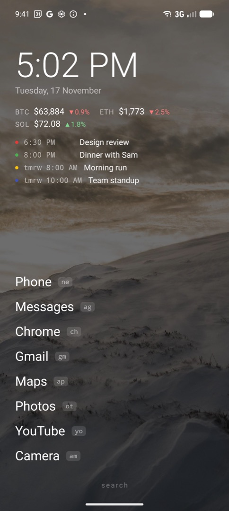
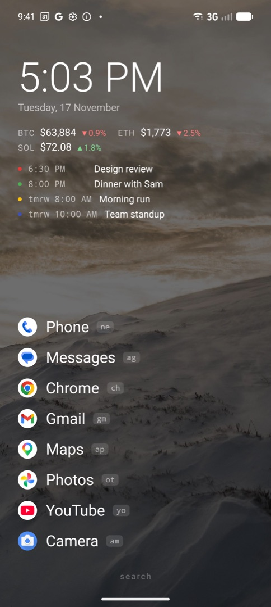
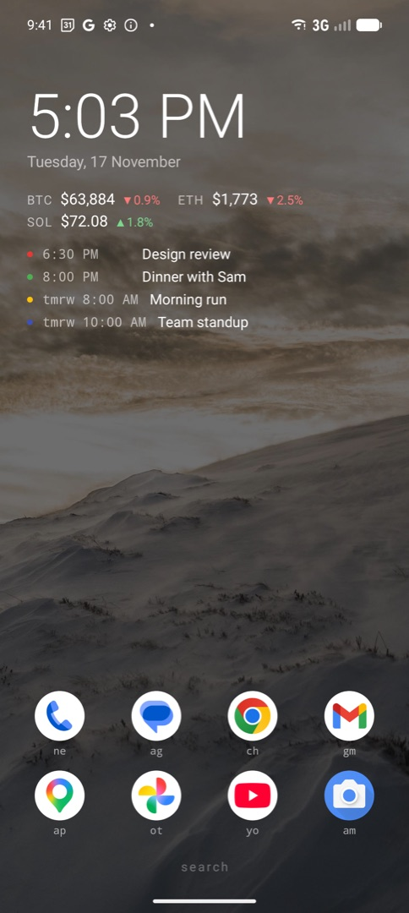
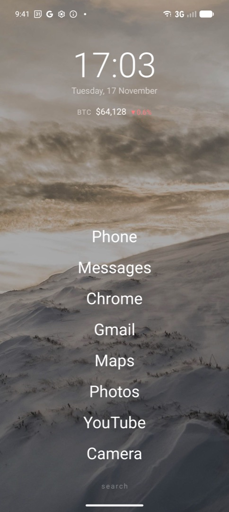
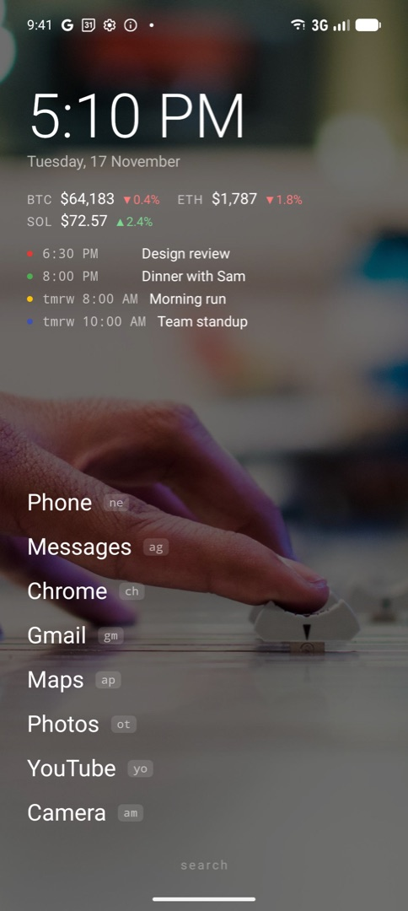
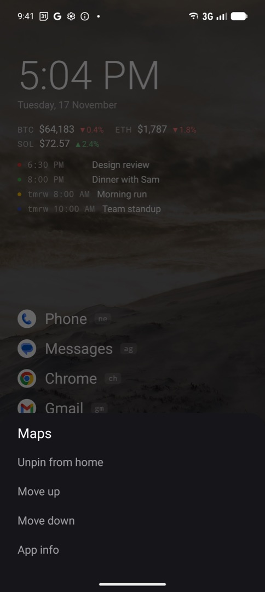
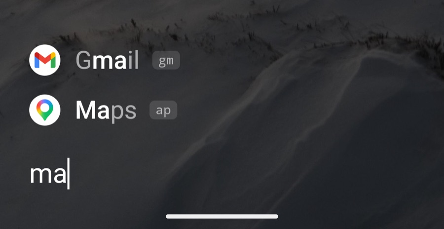
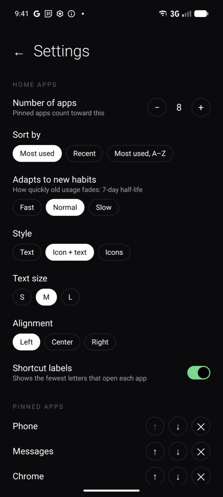
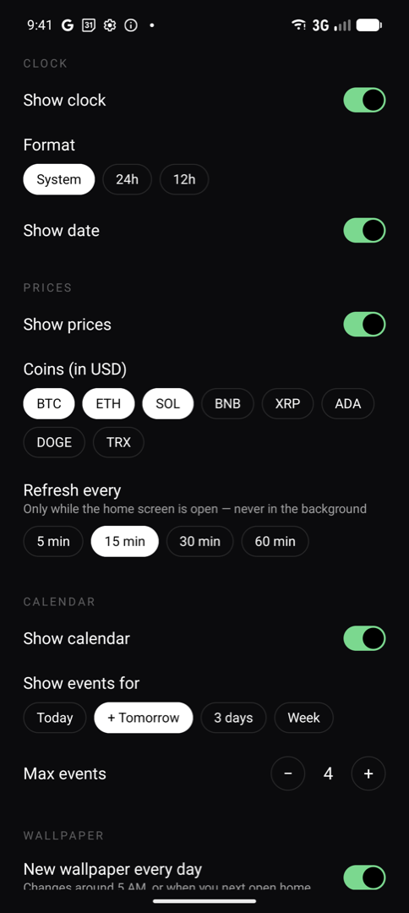
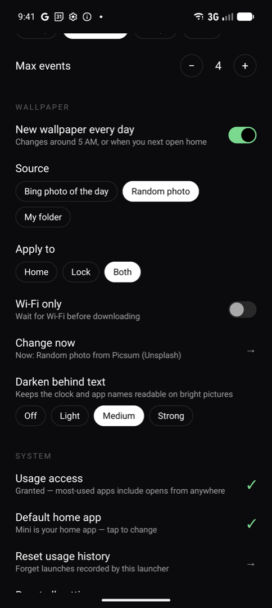

# Mini

A minimal, fast Android launcher (Kotlin + Jetpack Compose).

- **Type to launch** – the list narrows as you type and opens the app as soon as only one matches. Each app shows a hint with the shortest thing to type to reach it.
- **Home screen** – most-used apps (detected from usage stats), pinned apps, clock, upcoming calendar events and crypto prices.
- **Daily wallpaper** – Bing photo of the day, a random photo, or one from your own folder.
- **Settings** – long-press empty space on the home screen.

Gestures: swipe up to search, swipe down for notifications, long-press an app for pin / app info / uninstall.

## Screenshots

| Text | Icon + text | Icons |
|:---:|:---:|:---:|
|  |  |  |

| Centered, large, 24h, light dim | Daily wallpaper (random photo) | Long-press an app |
|:---:|:---:|:---:|
|  |  |  |

**Search** — typing `ma` narrows to Gmail and Maps (matched letters in bold, shortcut labels on the right); one more letter opens the app.



**Settings** — long-press empty space on the home screen.

| Home apps & pins | Clock, prices, calendar | Wallpaper & system |
|:---:|:---:|:---:|
|  |  |  |

## Build

Requires JDK 17 and the Android SDK (minSdk 29, targetSdk 36).

```sh
./gradlew :app:assembleRelease   # app/build/outputs/apk/release/app-release.apk
./gradlew :app:testDebugUnitTest
adb install -r app/build/outputs/apk/release/app-release.apk
```

The release build is signed with the debug key — fine for personal use, not for distribution.
